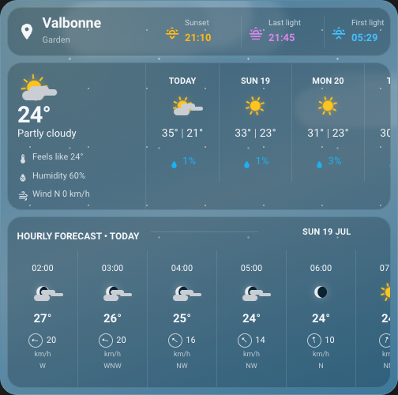
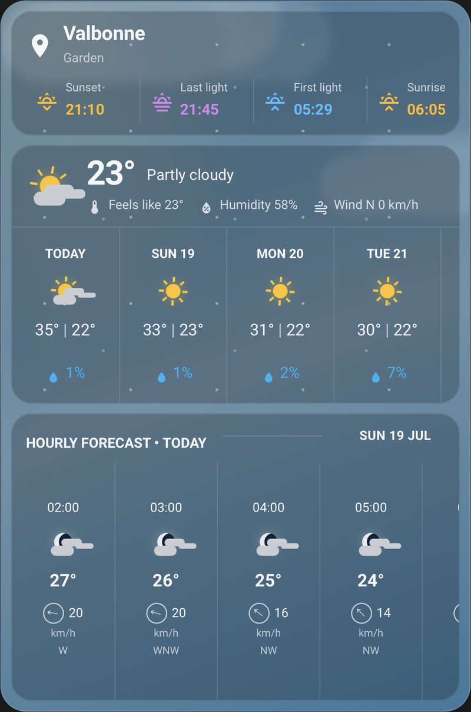

<div align="center">



# 🌤️ Bubble Weather Pro

**A premium, Apple Weather–inspired dashboard module for [Bubble Card](https://github.com/Clooos/Bubble-Card)**

[](https://github.com/Zak-Murdoch/ha-bubble-weather-pro/releases/latest)
[](LICENSE)
[](https://www.home-assistant.io/)
[](https://github.com/Clooos/Bubble-Card)
[](https://github.com/Zak-Murdoch/ha-bubble-weather-pro/stargazers)
[](CONTRIBUTING.md)

[Screenshots](#-screenshots) • [Installation](#-installation) • [Configuration](#️-configuration) • [Examples](#️-examples) • [Community](#-community) • [Roadmap](#️-roadmap)

</div>

---

## ✨ Overview

**Bubble Weather Pro** transforms a standard Home Assistant weather entity into a beautiful, animated, Apple Weather–style dashboard card, built as a module for [Bubble Card](https://github.com/Clooos/Bubble-Card).

It's designed for people who want their weather dashboard to feel like a premium mobile app — not a raw data table.

---

## 📸 Screenshots

<div align="center">

<table>
<tr>
<td align="center"><b>Desktop</b></td>
<td align="center"><b>Mobile</b></td>
</tr>
<tr>
<td valign="top"></td>
<td valign="top"></td>
</tr>
</table>

> 🎞️ **Animated demo coming soon** — a short GIF showing live icon animations and the hourly forecast scroll. See [Images & Assets](#️-images--assets).

</div>

---

## 🚀 Features

- 🎨 **Animated weather icons** — smooth, condition-aware icon animations (sun, clouds, rain, snow, storms, fog)
- 🌈 **Dynamic weather backgrounds** — background gradients shift with current conditions and time of day
- 📊 **Current conditions** — temperature, feels-like, condition text, and key metrics at a glance
- ⏱️ **Hourly forecast** — scrollable hour-by-hour strip (4–24 hours)
- 📅 **Daily forecast** — multi-day outlook with high/low temps and condition icons (1–10 days)
- 🌅 **Sunrise & sunset** times
- 🌄 **First light & last light** (civil twilight)
- 🌕 **Moon phase** display — optional dedicated moon entity or calculated fallback
- 💨 **Wind** speed and direction
- 💧 **Humidity**
- ☔ **Rain probability**
- 📱 **Fully responsive layout** — desktop, tablet, and mobile breakpoints
- 🧩 **Native Bubble Card module import** — one URL, no custom card boilerplate

---

## 📦 Installation

### Requirements

| Requirement | Minimum version |
|---|---|
| Home Assistant | 2024.6+ |
| [Bubble Card](https://github.com/Clooos/Bubble-Card) | 2.0+ (installed via HACS) |
| A configured `weather.*` entity | any compatible integration — see [Supported Weather Integrations](#-supported-weather-integrations) |

### Step 1 — Install Bubble Card

If you don't already have Bubble Card installed:

1. In HACS, search for **Bubble Card** and install it.
2. Add the Bubble Card resource if HACS didn't do it automatically (**Settings → Dashboards → Resources**).

Full details: [Bubble Card installation guide](https://github.com/Clooos/Bubble-Card#installation).

### Step 2 — Import the Bubble Weather Pro module

Bubble Card supports **module import** directly from a URL — no file copying or HACS entry required.

1. Open any Bubble Card card in the dashboard editor.
2. Click **Manage modules → Import module**.
3. Paste this URL:

   ```text
   https://raw.githubusercontent.com/Zak-Murdoch/ha-bubble-weather-pro/main/module/bubble-weather-pro.yaml
   ```

4. Click **Import**, then **Save**.

The module is now available to any Bubble Card card as **Bubble Weather Pro**.

> For a fully manual install (offline / air-gapped), see [`docs/installation.md`](docs/installation.md#manual-installation).

### Step 3 — Add the card

```yaml
type: custom:bubble-card
card_type: pop-up
modules:
  - bubble-weather-pro
entity: weather.home
```

See [`examples/`](examples/) for full working dashboards, and [`docs/configuration.md`](docs/configuration.md) for every option.

---

## ⚙️ Configuration

Minimal example:

```yaml
type: custom:bubble-card
card_type: pop-up
modules:
  - bubble-weather-pro
entity: weather.home
```

Full example with all options set explicitly:

```yaml
type: custom:bubble-card
card_type: pop-up
modules:
  - bubble-weather-pro
entity: weather.home
weather_pro:
  moon_entity: sensor.moon_phase
  sun_entity: sun.sun
  show_hourly: true
  hourly_hours: 12
  show_daily: true
  daily_days: 7
  show_wind: true
  show_humidity: true
  show_rain_probability: true
  animated_icons: true
  dynamic_background: true
  temperature_unit: auto
  first_last_light: true
```

Every option, its default value, and worked examples are documented in **[`docs/configuration.md`](docs/configuration.md)**.

---

## 🗂️ Examples

Ready-to-paste dashboard configs live in [`examples/`](examples/):

| File | Description |
|---|---|
| [`minimal.yaml`](examples/minimal.yaml) | Smallest possible working config |
| [`simple-card.yaml`](examples/simple-card.yaml) | Single-entity card with common overrides |
| [`apple-weather.yaml`](examples/apple-weather.yaml) | Full Apple Weather–style layout, all sections enabled |
| [`full-dashboard.yaml`](examples/full-dashboard.yaml) | Weather card inside a complete example dashboard view |
| [`compact-mobile.yaml`](examples/compact-mobile.yaml) | Condensed layout tuned for phone-sized dashboards |

---

## 🌦️ Supported Weather Integrations

Bubble Weather Pro works with **any** integration that exposes a standard `weather.*` entity, including:

- Met.no (built-in, no API key)
- OpenWeatherMap
- AccuWeather
- Pirate Weather
- Tomorrow.io
- WeatherFlow / Tempest
- Ecobee weather
- National Weather Service (NWS, US)

Anything that provides `forecast_daily` / `forecast_hourly` data via the `weather.get_forecasts` service will populate the daily and hourly sections automatically. See [`docs/configuration.md#weather-providers`](docs/configuration.md#weather-providers) for provider-specific notes and quirks.

---

## 🌕 Optional Moon Integration

The moon phase panel uses Home Assistant's built-in **Moon** integration (`sensor.moon_phase` — enable it under **Settings → Devices & Services → Add Integration → Moon**).

If no `moon_entity` is configured, the module falls back to a calculated moon phase using sun/date data — no extra integration required. See [`docs/configuration.md#moon-integration`](docs/configuration.md#moon-integration).

---

## 🛠️ Troubleshooting

Common fixes live in **[`docs/troubleshooting.md`](docs/troubleshooting.md)**, covering:

- Module not appearing in Bubble Card's module list
- Icons not animating
- Forecast sections empty
- Wrong sunrise/sunset or first/last light times
- Layout breaking on small screens

---

## ❓ FAQ

See **[`docs/faq.md`](docs/faq.md)** for the most common questions, including why HACS isn't used, theming, multi-location setups, wall panels, and licensing.

---

## 💬 Community

Have a question, idea, or want to share your setup?

- **[Discussions](https://github.com/Zak-Murdoch/ha-bubble-weather-pro/discussions)** — questions, ideas, and dashboard showcases
- **[Issues](https://github.com/Zak-Murdoch/ha-bubble-weather-pro/issues)** — bug reports and feature requests (please use the templates)
- **[Contributing guide](CONTRIBUTING.md)** — how to submit a pull request

---

## 🗺️ Roadmap

Planned for future releases — see [open issues](https://github.com/Zak-Murdoch/ha-bubble-weather-pro/issues) to vote or contribute:

- [ ] 📡 Radar overlay
- [ ] ☀️ UV index
- [ ] 🌫️ Air quality index
- [ ] 🤧 Pollen count
- [ ] 🌡️ Barometric pressure trend
- [ ] ⚠️ Weather alerts / warnings banner
- [ ] 📍 Multiple locations / location switcher
- [ ] 🎨 Theme packs (dark, minimal, high-contrast, seasonal)
- [ ] 📈 Interactive historical/forecast charts
- [ ] 🌀 Additional weather animations (hail, sleet, dust)
- [ ] 🌍 Localisation / i18n for labels and units

Completed milestones are recorded in [`CHANGELOG.md`](CHANGELOG.md).

---

## 🖼️ Images & Assets

| File | Status | Description |
|---|---|---|
| `images/desktop.png` | ✅ included | Desktop dashboard view |
| `images/mobile.png` | ✅ included | Mobile dashboard view |
| `images/animation.gif` | 🔲 needed | 5–10 s animated demo of icon animation and hourly scroll |

To add the GIF: record a short screen capture of the card using QuickTime, OBS, or ScreenToGif, convert with `gifski` or [ezgif.com](https://ezgif.com) (keep under 8 MB), and drop it in `images/animation.gif`.

See [`images/README.md`](images/README.md) for capture guidelines.

---

## 🤝 Contributing

Contributions are welcome — bug reports, features, docs, examples, and translations alike. Please read **[`CONTRIBUTING.md`](CONTRIBUTING.md)** before opening a pull request, and review the **[Code of Conduct](CODE_OF_CONDUCT.md)**.

## 🔒 Security

Found a security issue? Please see **[`SECURITY.md`](SECURITY.md)** for responsible disclosure instructions.

## 🙏 Acknowledgements

- [Bubble Card](https://github.com/Clooos/Bubble-Card) by [Clooos](https://github.com/Clooos) — the module framework this project builds on
- [Home Assistant](https://www.home-assistant.io/) and its weather integration maintainers
- The Home Assistant community for testing, feedback, and inspiration

## 📄 License

Released under the [MIT License](LICENSE).

</div>
